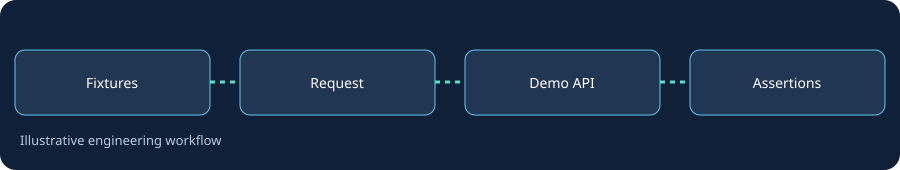
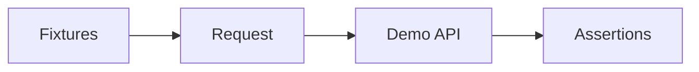

# API Automation Testing Framework

<!-- portfolio-visual-start -->
## Engineering overview

 





Illustrative workflow: Fixtures → Request → Demo API → Assertions. See the implementation and setup below for actual capabilities and prerequisites.

[Developer profile](https://github.com/ABHILASH9519) · [Issues](https://github.com/ABHILASH9519/API-Automation-Testing-Framework/issues)
<!-- portfolio-visual-end -->


A reusable Python/Pytest framework for REST API validation, including a deterministic local demo API so the suite runs without external accounts or API keys.

## Quick start
```sh
python -m venv .venv
# activate the environment
python -m pip install -r requirements.txt
pytest -q
```

Start the demo API for Postman:
```sh
uvicorn demo_api.main:app --reload
```
Import `postman/collection.json` into Postman. Its `baseUrl` variable defaults to `http://127.0.0.1:8000`.

## Coverage
- Health and resource endpoint contract checks
- Create, read, not-found, missing-field and boundary validation
- Reusable Pytest fixtures and isolated test state
- Postman collection with executable response assertions
- GitHub Actions regression test workflow

The demo service stores data in memory and is intended for local testing, not production persistence.